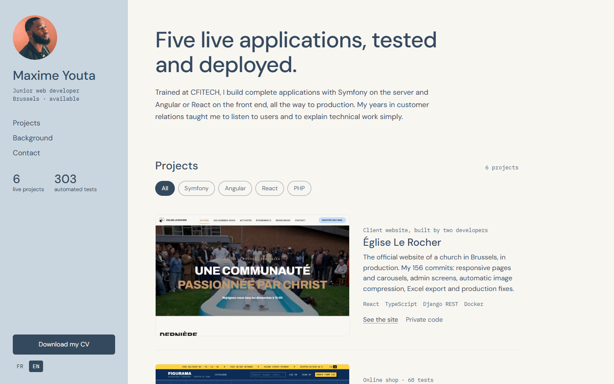
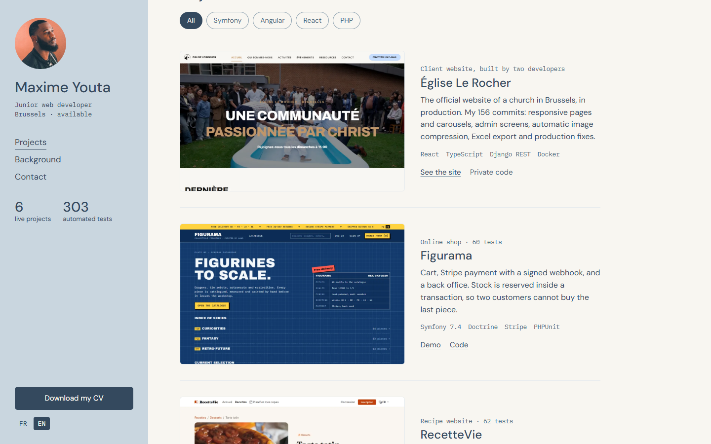
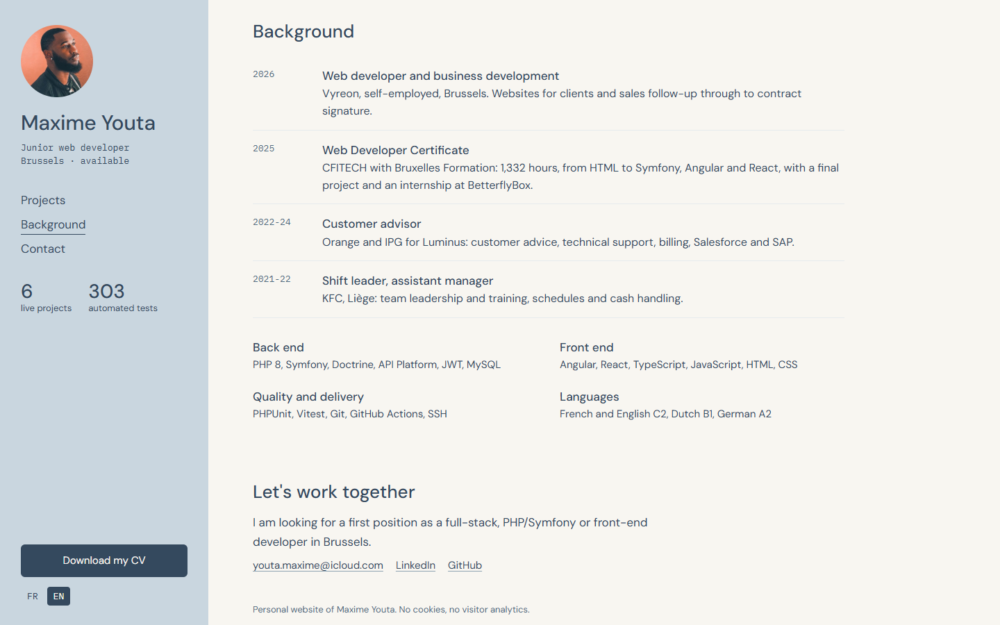
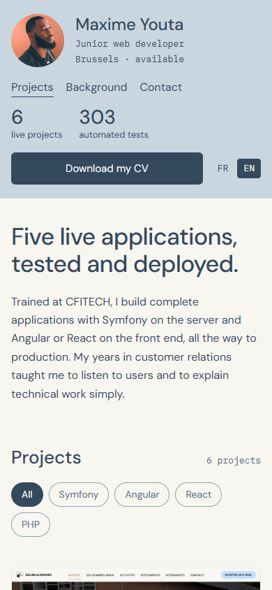
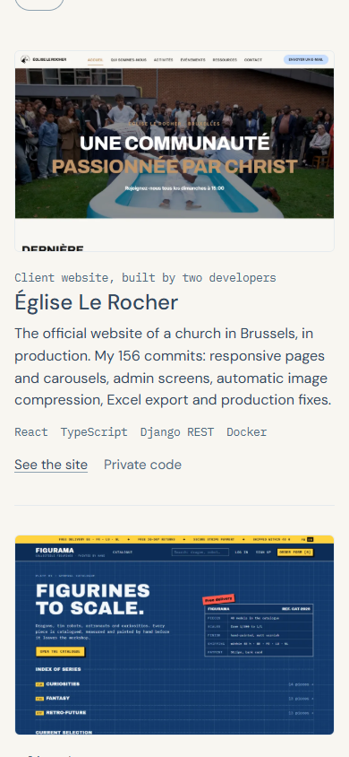

# Portfolio

*Mon site de présentation : mes projets, mon parcours et mon CV, en français et en anglais.*

The personal website of Maxime Youta, junior web developer in Brussels. One fast page that lets a recruiter see who I am, filter my projects by technology, open each demo or its code, and download my CV.

### [Visit the site](https://puremax-lab.github.io/)



## Why it is built this way

| Choice | Reason |
|---|---|
| **Plain HTML, CSS and TypeScript** | A one-page site needs no framework. The JavaScript bundle stays under 7 kB |
| **The content is in the HTML** | Without JavaScript the page still shows everything, in French |
| **French in the page, English in [`i18n.ts`](src/i18n.ts)** | A test fails if a text has no English version, or if a key is left over |
| **Fonts in the bundle** | No request to a third party, no cookies, no analytics |
| **Relative paths** | The site works at the root of a domain or in a sub-folder |

## What a visitor can do

- **Filter projects** by technology ([`filter.ts`](src/filter.ts)), with a live count read out by screen readers
- **Switch between French and English** at once. A first visit follows the language of the browser, with English for any language other than French or English, and the choice is then remembered
- **Download the CV** in the language of the page
- **See where they are**: the side menu underlines the section being read

The side column stays in view on a computer and becomes a compact header on a phone.

| Projects | Background | Phone |
|---|---|---|
|  |  |  |



## Quality

- **17 Vitest tests** on the real `index.html`: language rule, switching and coming back, every key translated, each filter, and the link and image of every project
- **GitHub Actions** runs the tests and the build on every push, then deploys to GitHub Pages
- Checked in Chrome from 390 px to 1440 px, with no horizontal scroll

## Run it

```bash
npm install
npm run dev
npm test
npm run build
```

## Images

The screenshots show my own projects, and the portrait is of me. No stock image is used.

## Contact

[LinkedIn](https://www.linkedin.com/in/maxime-youta-1298a2375/) · [GitHub](https://github.com/puremax-lab)
